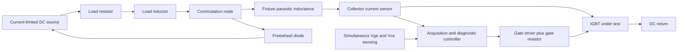

# Electrical-only IGBT test-cell solution

Scope: device electrical characterization, gate driving, switching, commutation and electrical diagnostics. Existing validated models and results are preserved. Other domains are outside this assessment. All non-Wabtec device/fixture values below are illustrative; no locomotive module ratings or acceptance limits are inferred.

## What the completed electrical results establish

Source data: results/static25_20261017_165838_504 and results/dynamic_20261017_165933_696. Static comparisons use one common reference operating condition; do not mix unlike conditions when assessing degradation.

| Electrical property | Executed result | Engineering interpretation |
|---|---|---|
| Gate command | +15 V / -15 V | Matches Wabtec slides 5/8; actual terminal Vge is measured. This does not establish absolute gate-voltage ratings. |
| On-state voltage | Approximately 2.000 V at 20 A, Vge=15 V | Recovers the assumed model calibration. Instantaneous conduction power at that point is approximately 40 W. |
| On-state curve | Vce about 1.196 V at 10 A; 2.869 V at 30 A | Incremental slope is about 83.65 milliohm over this interval. Vce/I=100 milliohm at 20 A is an apparent ratio, not a constant resistance model. |
| Off-state collector leakage | Approximately 8.29 microampere at 48 V; 10.01 microampere at 100 V | Demonstrates model blocking at these simulated points only. It does not establish rated blocking voltage or breakdown capability. |
| Gate sensitivity | 5 V is below the assumed 6 V threshold; 7 V gives limited current; 15 V gives much stronger conduction | Threshold is not the fully-enhanced gate-drive voltage. Compare currents at the same measured Vce; use gate_comparison.csv from the assessment. |
| Peak gate current | Approximately 4.17 A during a transition | Consistent with a 30 V swing through 2 + 4.7 + 0.5 = 7.2 ohm nominal drive resistance. This is peak pulse current, not average driver power. |
| Gate charge | Approximately 164 nC for the second positive transition | Integral of gate current from -15 to +15 V in the saved event window. It is not directly a datasheet gate-charge number measured from 0 V. |
| RL switching | 48 V bus, 2 ohm, 1 mH, 100 nH commutation inductance | Peak Ic approximately 10.395 A and Vce approximately 51.143 V. Voltage above the bus includes diode clamping and parasitic effects; it cannot all be attributed to L di/dt. |
| Normal turn-off current clearance | Approximately 48.35 us to the defined 1 percent current criterion | A property of the assumed stored-charge model. It is not a measured desaturation-protection response. |
| Numerical consistency | KCL, inductor voltage integral and terminal-energy balance pass; half-step event-energy changes below 0.121 percent | Supports numerical consistency of this experiment, not manufacturer accuracy or hardware certification. |

At Vge=0 and -15 V, the present model gives nearly identical settled collector leakage. It therefore does not demonstrate the dynamic immunity benefit of negative gate bias. Gate insulation leakage and oxide breakdown are not characterized by a purely capacitive gate representation.

## Proposed electrical bench topology

Measure **Vge, Vce, Ic and Ig**, plus **IL and Id** in the inductive fixture. Collector current and load current serve different diagnostic purposes. A real installation needs appropriately isolated sensing and validated source current limiting; the existing source and sensors are ideal simulation elements.

Keep separate fixtures for voltage-driven output/leakage sweeps, current-driven Vce(sat) characterization, resistive switching and inductive double-pulse switching. An ideal current source in the characterization model is not a complete hardware current regulator.

## Automated electrical test sequence

| Stage | Test and electrical observations | Diagnostic purpose |
|---|---|---|
| 1. Gate path | Check terminal Vge levels, charge/discharge current and timing before applying the main test pulse | Separate driver/wiring faults from transistor conduction faults. DC gate-insulation leakage requires an added validated leakage model and measurement method. |
| 2. OFF blocking | Apply selected bus steps with gate OFF; sample settled Ic and Vce | Detect abnormal leakage or a C-E bypass/short candidate. Use device-specific allowed test voltages, not the illustrative 100 V as a rating. |
| 3. ON conduction | At specified current points and verified gate voltage, measure Vce(sat) and the I-V curve | Identify an open path or increased on-state voltage relative to an approved reference envelope. |
| 4. Resistive switching | Record command, Vge, Vce and Ic edges | Measure command-to-response delay and 10/90 percent transition times without inductive commutation ambiguity. |
| 5. Inductive double pulse | Establish load current; turn OFF into the diode; apply a second pulse | Assess hard switching, gate dynamics, voltage overshoot, current tail and freewheel behavior. |
| 6. Protection | Create a separately validated out-of-saturation scenario; record fault onset, detection, trip command, gate response and current clearance | Verify each protection-chain delay individually. This stage is not implemented or validated yet. |
| 7. Reset | Verify load-energy discharge before another experiment | Prevent residual inductor current from contaminating the next test or being misclassified as transistor leakage. |

The validated double pulse is ON at 50-300 us and 400-500 us, with a 100 us freewheel gap. The gap was chosen after the original 50 us gap left approximately 1.5 percent tail current. The 1.5 ms record does not represent a fully discharged load: approximately 0.553 mJ remains in the 1 mH inductor, corresponding to about 1.05 A. Extend the discharge observation or use a state-based completion condition before repeating the test.

Static 2 us records check consistency of an independently solved DC point. They do not establish hardware acquisition dwell, relay settling or instrument integration time. Production durations need those additional timing measurements and a defined electrical test matrix; 3.5 minutes is a user-supplied reference, not a derivation of the simulated durations.

## Electrical fault interpretation

| Observed combination | Candidate diagnosis | What must be excluded |
|---|---|---|
| Correct ON gate, high Vce, missing expected Ic | Open conduction path | Open load, connector, source or current-sensor error. |
| Correct OFF gate, sustained collector current and low Vce after the defined clearing interval | C-E short/bypass | External wiring bypass and acquisition errors. Load current alone is insufficient. |
| Incorrect gate voltage plus poor conduction | Gate-drive abnormality | Avoid labeling the IGBT defective before verifying its actual Vge. |
| Higher Vce at the same Ic and Vge | Increased conduction-loss candidate | Changed operating conditions, fixture/contact resistance and measurement offset. |
| Increased OFF Ic at the same Vce and gate condition | Leakage degradation candidate | Measurement floor, fixture leakage and changed conditions. |
| Excess delay or current tail | Switching abnormality candidate | Gate resistance, capacitance, driver propagation and charge-storage assumptions. |
| Missing freewheel current or unexpected switch-node voltage | Diode/commutation-path fault candidate | Do not automatically attribute an external diode fault to the IGBT. |

These are diagnostic hypotheses. Fault-injected models have not yet validated their classification coverage. No arbitrary absolute thresholds are introduced here.

## Electrical gaps that matter before a health verdict

- Identify the actual module and obtain Vces/Ic ratings, SOA, gate limits, permitted test conditions, leakage limits and switching-characteristic definitions.
- Define acceptance envelopes from approved data or a qualified healthy reference, including acquisition uncertainty. Current numerical tolerances are solely simulation checks.
- The external diode currently models conduction and capacitance, not reverse-recovery stored charge. At about 10 A its assumed 0.8 V plus 0.01 ohm law gives about 0.9 V, so it is not fitted to the presentation's 0.2-0.8 V reference range; the slide does not state the associated current.
- Event integrals int(Vce*Ic dt) include conduction and reactive energy transfer. They must not be presented as pure Eon/Eoff dissipation without a defined subtraction and stored-energy treatment.
- Implement and test desaturation blanking, qualification and propagation separately. Wabtec's approximately 10 us protection reference is not interchangeable with the approximately 48.35 us normal current-clearance result of this assumed device.

Decision policy: numerical experiment PASS/FAIL is distinct from hardware health. Approved limits absent means **hardware INCONCLUSIVE**. With approved limits, use PASS when every required electrical result is inside its acceptance envelope with uncertainty accounted for, FAIL for a confirmed violation, and INCONCLUSIVE for incomplete, ambiguous or invalid measurements.

The next electrical implementation should validate one open-path scenario and one C-E short/bypass scenario against the preserved healthy R/RL fixtures, then add gate-drive abnormalities and the desaturation controller. The existing models provide the acquisition channels needed for those tests.
